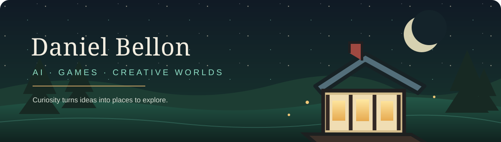
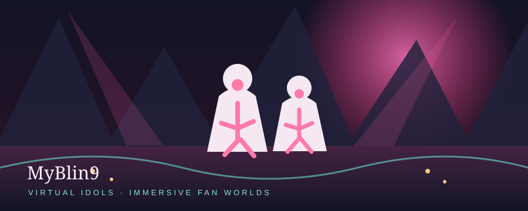
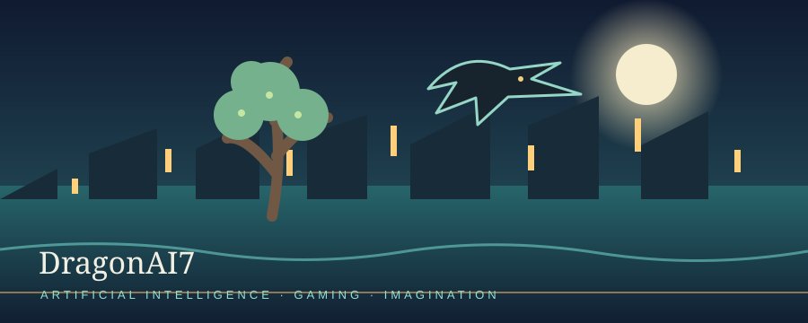
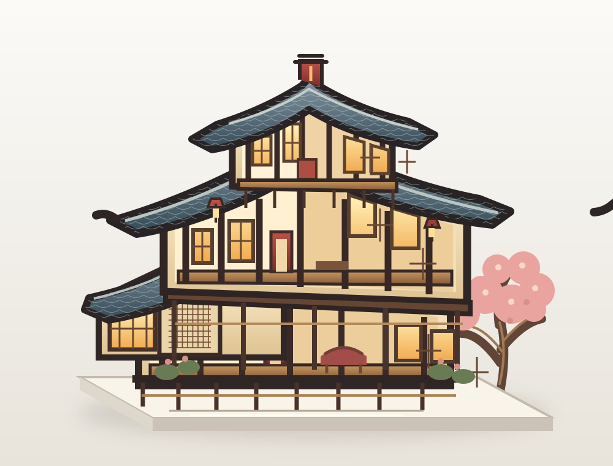

  

<h1 align="center">Hey, I'm Daniel 👋</h1>

<strong>Creative builder · AI explorer · lifelong gamer</strong>

I love turning curiosity into things people can explore: imaginative worlds, helpful AI systems, memorable characters, and experiences that feel good to spend time in. I'm especially drawn to cozy-futuristic design, creative freedom, and adventures with a sense of discovery.

## A few worlds I'm building and exploring

| MyBlin9 · Live site | DragonAI7 · Blog | Witchlight House · Concept |
| --- | --- | --- |
|  |  |  |
| An AI-entertainment platform centered on virtual idols and immersive fan interaction. [Visit the site ↗](https://myblin9.com) | My creative blog about AI, gaming, and ideas for imaginative worlds. [Visit DragonAI7 ↗](https://dragonai7.blogspot.com/) | An early fantasy-home idea inspired by a miniature pavilion pin. This is concept artwork, not a finished home or live interactive demo. [See the artwork ↗](showcase/witchlight-pavilion.svg) · [Style inspiration ↗](https://www.pinterest.com/pin/745908757044638843/) |

## Things I'm imagining and exploring

| Project | What it is |
| --- | --- |
| [MyBlin9](https://myblin9.com) | An AI-entertainment platform concept focused on virtual idols and immersive fan interaction. [GitHub fork](https://github.com/bellon118-wq/myblin9) |
| [DragonAI7](https://dragonai7.blogspot.com/) | My blog about AI, gaming, creative technology, and the worlds those ideas can unlock. |
| **AI_Workspace** | A personal workspace for AI agents, personas, and custom creative workflows. |
| **AstraeaNPCProject** | A game-world concept exploring NPC personalities, dialogue, and behavior. |
| **VISTAChain** | A prompt-to-video workflow concept for shaping an idea into a visual story. |

Some entries are concepts or personal workspaces, not finished or publicly released products.

## Worlds I love exploring

**Aion 2** · **Once Human** · **Neverness to Everness (NTE)** · **Infinity Nikki** · **The Witcher**

I enjoy beautiful worlds, base-building, customization, companions, lore, and relaxed exploration as much as the technology behind them.

## Open-source projects I'm exploring

These are **forks**, shared here as projects I'm learning from and following—not work I claim to have authored:

- [MOSS-Image](https://github.com/OpenMOSS/MOSS-Image) — text-aware image generation and layout tools
- [WorldPlay2](https://github.com/WorldPlay2/WorldPlay2) — real-time interactive world models
- [Streaming Code World Model](https://github.com/TingtingLiao/streaming-code-world-model) — streaming code and world-model research

## Find me around the web

[MyBlin9](https://myblin9.com) · [DragonAI7 blog](https://dragonai7.blogspot.com/) · [GitHub repositories](https://github.com/bellon118-wq?tab=repositories)

Always collecting ideas. Always building toward the next world.
