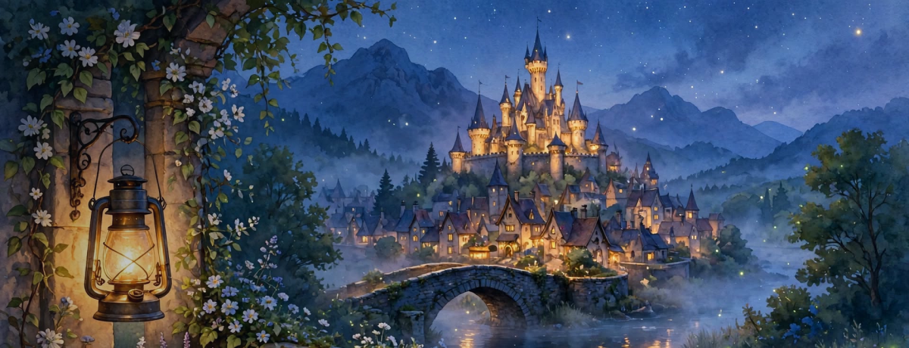
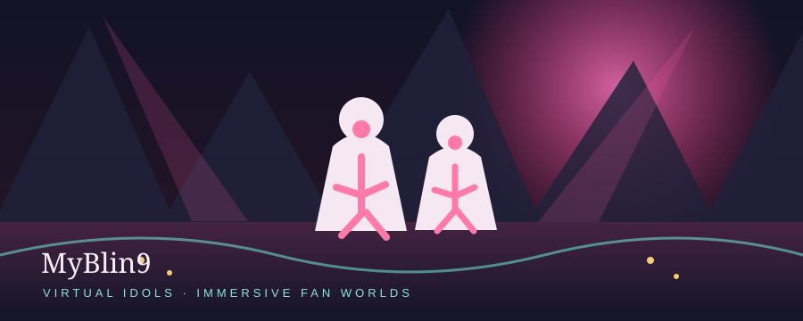
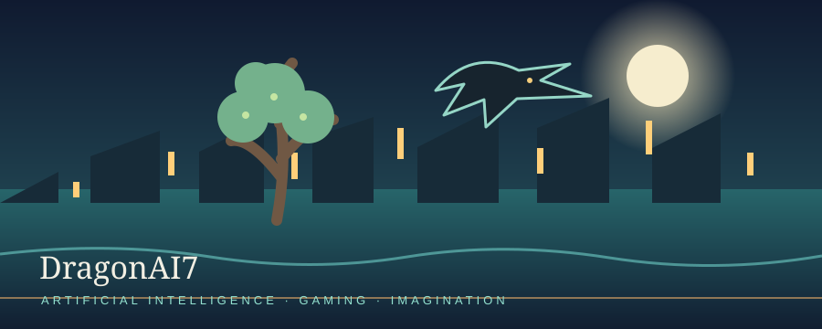

  

<h1 align="center">Daniel Bellon</h1>

<strong>AI Creator · Gamer · Digital Worldbuilder</strong>

  I turn curiosity into creative tools, virtual entertainment, memorable characters, and worlds worth exploring.

  <a href="https://bellon118-wq.github.io/bellon118-wq/">✦ Enter Mayflower Sanctuary</a>
  &nbsp;·&nbsp;
  <a href="https://x.com/danielbellon108">Follow on X</a>
  &nbsp;·&nbsp;
  <a href="https://github.com/bellon118-wq?tab=repositories">Browse my repositories</a>

<h2 align="center">✧ CREATOR DOSSIER ✧</h2>

<table>
  <tr>
    <td><strong>CLASS</strong> AI Creator</td>
    <td><strong>FACTION</strong> MYBLIN9</td>
    <td><strong>HOME BASE</strong> Boston, MA</td>
    <td><strong>CURRENT MODE</strong> Building & exploring</td>
  </tr>
</table>

## Active quests

| Quest log | Current focus |
| --- | --- |
| **MYBLIN9** | Exploring virtual idols and immersive fan experiences. |
| **DragonAI7** | Writing about AI, gaming, creative technology, and imaginative worlds. |
| **Website development** | Growing Mayflower Sanctuary into a game-inspired creative portfolio. |
| **AI character creation** | Developing character and NPC concepts; concepts are labeled as such. |

## Worlds and projects

| MyBlin9 · Live site | DragonAI7 · Blog | Witchlight House · Concept |
| --- | --- | --- |
|  |  |  |
| An AI-entertainment platform centered on virtual idols and immersive fan interaction. [Visit MyBlin9 ↗](https://myblin9.com) | My creative blog about AI, gaming, and ideas for imaginative worlds. [Visit DragonAI7 ↗](https://dragonai7.blogspot.com/) | An early fantasy-home idea inspired by a miniature pavilion pin—not a finished home or live demo. [View the concept ↗](showcase/witchlight-pavilion.svg) |

**Other concepts in my notebook:** AI_Workspace (agents, personas, and creative workflows) · AstraeaNPCProject (NPC personalities and behavior) · VISTAChain (a prompt-to-video workflow concept).

  <a href="https://bellon118-wq.github.io/bellon118-wq/">Explore the Mayflower Sanctuary portfolio ↗</a>

## Worlds I love exploring

**Aion 2** · **Once Human** · **Neverness to Everness** · **Zenless Zone Zero** · **Infinity Nikki** · **The Witcher**

Beautiful worlds, customization, companions, lore, base-building, and relaxed exploration are all part of the adventure.

## Creator attributes

Playful self-ratings—not measured performance.

| Creativity | Worldbuilding | Technical skills | Marketing | Community |
| ---: | ---: | ---: | ---: | ---: |
| 95 | 90 | 88 | 92 | 85 |

## Current loadout

GitHub Copilot · VS Code · Windows 11 · RTX gaming PC · Creative AI tools

## Open-source worlds I'm exploring

These are **forks and projects I follow**, not work I claim to have authored:

- [MOSS-Image](https://github.com/OpenMOSS/MOSS-Image) — text-aware image generation and layout tools
- [WorldPlay2](https://github.com/WorldPlay2/WorldPlay2) — real-time interactive world models
- [Streaming Code World Model](https://github.com/TingtingLiao/streaming-code-world-model) — streaming code and world-model research

## Find me around the web

[Mayflower Sanctuary](https://bellon118-wq.github.io/bellon118-wq/) · [MyBlin9](https://myblin9.com) · [DragonAI7 blog](https://dragonai7.blogspot.com/) · [X](https://x.com/danielbellon108) · [YouTube Community](https://youtube.com/@DanielBellon108/community) · [GitHub repositories](https://github.com/bellon118-wq?tab=repositories) · [Website specification](https://github.com/bellon118-wq/bellon118-wq/blob/main/COPILOT_WEBSITE_SPEC.md)

Always collecting ideas. Always building toward the next world.

