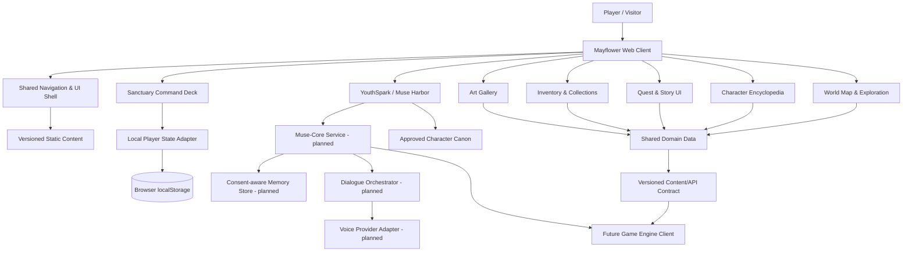

# Mayflower Sanctuary — System Architecture & Data Plan
**Version:** 1.0 · 2026-11-19  
**Status:** Target architecture; staged implementation  
**Runtime today:** Static GitHub Pages + vanilla HTML/CSS/JavaScript + JSON + browser-local state.

## Architecture diagram


## Current vs target boundaries
### Implemented today
- Static multi-page website hosted on GitHub Pages.
- HTML pages, shared stylesheets, vanilla JavaScript interactions.
- JSON content files and local image assets.
- Browser-local settings, achievements, codex favorites/recent views, companion progress, scrapbook notes and Command Deck checklist.

### Proposed, not connected
- Muse-Core runtime and memory database.
- User accounts, authenticated APIs and cross-device synchronization.
- Live AI dialogue generation and provider-backed voice synthesis.
- Multiplayer presence, server-authoritative world events and shared progression.
- Future game-engine runtime integration.

Never label a proposed component as deployed. Client-side state must not be treated as trusted or authoritative for purchases, multiplayer, rewards or user identity.

## Domain entities and stable identifiers
Use lowercase kebab-case or stable UUIDs for IDs; never use display names as foreign keys. Display names may change while IDs remain stable.

| Entity | Required fields | Key relationships |
|---|---|---|
| Character | id, name, canonVersion, role, factionId, status, publicationStatus | homeLocationId, artworkIds, questIds, storyIds, dialogueProfileId |
| Faction | id, name, description, canonVersion | characterIds, regionIds, projectIds |
| Region | id, name, mapAssetId, description, status | locationIds, questIds |
| Location | id, regionId, name, description, mapMarker, artworkIds | residentCharacterIds, questIds, loreEntryIds |
| Quest | id, title, status, objectives, prerequisites | characterIds, locationIds, rewardItemIds, storyId |
| QuestObjective | id, questId, type, description, targetRef, requiredCount | quest progress events |
| Item | id, name, category, rarity, iconAssetId, description | collectionIds, sourceQuestIds |
| Collection | id, name, itemIds, completionRules | rewardIds, galleryIds |
| Artwork | id, assetPath, mediaType, alt, approvalStatus, source | characterIds, locationIds, projectIds |
| LoreEntry | id, title, category, canonStatus, content, sourceRefs | characterIds, locationIds, questIds |
| TarocchiCard | id, title, suitOrArcana, artworkId, loreRefs, characterRefs | deckIds, collectionIds |
| PlayerProfile | id, displayName, createdAt, preferences | playerProgressId; account optional |
| PlayerProgress | playerId, schemaVersion, questStates, discoveries, inventory | event log, local or server adapter |
| MemoryRecord | id, schemaVersion, characterId, memoryType, content, source, privacy, consent | user scope, canon version, lifecycle metadata |

## Canonical content and directory policy
Current repository contains both `assets/data/` and `data/` JSON directories. Adopt `assets/data/` as the canonical public static-content directory because the existing `assets/js/main.js` loads from it and it already contains the richer character and games records plus the Muse-Core schema.

Migration rules:
1. Do not delete `data/characters.json` or `data/games.json` immediately.
2. Compare records and establish field-level differences.
3. Add a migration/compatibility script or temporary documented alias.
4. Update readers to the canonical source.
5. Add a CI check preventing duplicate/conflicting entity IDs.
6. Remove legacy files only in a later reviewed change after references are proven absent.

Keep character canon separate from player state. The YouthSpark canonical profile, expression bible, movement bible and animator reference are owner-approved content sources; player relationship progress must never overwrite those files.

## Suggested content contracts
### Character record (illustrative)
```json
{
  "id": "youthspark-muse",
  "schemaVersion": "1.0.0",
  "name": "YOUTHSPARK_Muse",
  "role": "AI Idol",
  "factionId": "myblin9",
  "canonVersion": "approved-version-id",
  "status": "active",
  "publicationStatus": "owner-confirmed-or-unconfirmed",
  "homeLocationId": "muse-harbor",
  "artworkIds": ["youthspark-portrait-primary"],
  "questIds": [],
  "storyIds": [],
  "dialogueProfileId": "youthspark-voice-profile"
}
```
Use real owner-confirmed values only. The illustrative empty arrays are not claims that the character has no stories or quests.

### Location record (illustrative)
```json
{
  "id": "muse-harbor",
  "schemaVersion": "1.0.0",
  "name": "Muse Harbor",
  "regionId": "sanctuary-coast",
  "mapMarker": {"x": 0.42, "y": 0.58},
  "residentCharacterIds": ["youthspark-muse"],
  "questIds": [],
  "artworkIds": []
}
```
Map coordinates are normalized UI coordinates, not geographic coordinates. Use actual owner-approved values when available.

### Quest record (illustrative)
```json
{
  "id": "quest-example",
  "schemaVersion": "1.0.0",
  "title": "Example quest",
  "status": "planned",
  "prerequisiteQuestIds": [],
  "objectives": [],
  "characterIds": [],
  "locationIds": [],
  "rewardItemIds": []
}
```

## Muse-Core memory contract
Keep the existing `assets/data/muse-core.schema.json` as a proposal and evolve it with explicit migration/version policy. Required memory categories:
- **Core:** stable, owner-approved character identity and canon. Not user-specific; changes only via reviewed canon version.
- **Relationship:** user-scoped relationship milestones and shared symbols; explicit, explainable events only.
- **Episodic:** time-stamped interaction summaries with provenance, privacy and retention.
- **Symbolic:** recurring motifs and themes linked to evidence; never convert symbolism into factual history without support.

Retrieval ranking may use relevance, emotional intensity, novelty, recurrence and recency. Filter by authorization, consent, source confidence and expiry before ranking. Ranking is not a truth score.

Every user-specific memory requires:
- Pseudonymous user scope and character ID.
- Consent status, purpose and timestamp.
- Provenance/source type and confidence.
- Privacy classification and retention/expiry policy.
- Created/updated timestamps and schema version.
- Export, correction and deletion path.

Never infer sensitive personal attributes. Never promote model-generated speculation into canon. Provide clear user controls to pause capture, review memories, correct records and request deletion.

## Persistence and synchronization stages
### Stage A — Static/local prototype
- Use a versioned adapter interface over localStorage.
- Validate stored values and handle parse/quota errors.
- Include reset/export behavior where appropriate.
- Clearly label state as this-browser-only.
- Do not trust local state for server-authoritative progression.

### Stage B — Authenticated backend
- Select a database and hosting provider only after security and cost review.
- Use server-side authorization and per-user data isolation.
- Encrypt data in transit and at rest.
- Use optimistic concurrency, idempotency keys and schema migrations.
- Add audit logging for administrative access and canon changes.

### Stage C — Multi-client synchronization
- Use versioned APIs and stable domain IDs.
- Use event/outbox processing for durable sync.
- Define conflict policy per data type; canon is owner-write/review, user progress is user-scoped, shared events are server-authoritative.
- Keep game client and website behind the same domain contracts.

## API contracts (future design only)
- `GET /v1/characters/{characterId}`
- `GET /v1/locations/{locationId}`
- `GET /v1/quests?regionId={regionId}`
- `GET /v1/users/{userId}/progress`
- `PATCH /v1/users/{userId}/progress`
- `GET /v1/users/{userId}/characters/{characterId}/memories`
- `POST /v1/memories`
- `PATCH /v1/memories/{memoryId}`
- `DELETE /v1/memories/{memoryId}`
- `POST /v1/dialogue`
- `POST /v1/voice/synthesize`

These are proposed contracts; no corresponding production endpoints are asserted to exist.

## Frontend module boundaries
Gradually separate the current broad `game.js` responsibilities into feature modules:
- `settings-store`
- `achievement-service`
- `companion-progress`
- `scrapbook`
- `dialogue-controller`
- `world-map-controller`
- `codex-controller`
- `relationship-graph`
- `gallery-controller`
- `audio-controller`

Keep a small bootstrap that initializes modules only when their DOM roots exist. Refactor one module at a time with behavior-preserving tests. Do not replace the current game layer wholesale.

## Validation and quality gates
- JSON Schema validation for all versioned data.
- Unique-ID and foreign-key/reference integrity checks.
- HTML internal-route, anchor and asset-path checks.
- Unit tests for quest transitions, collection rules, memory scoring and privacy filters.
- Regression tests for summon intro, settings, map pan/zoom, codex, dialogue, scrapbook, gallery/lightbox and achievements.
- Responsive tests at 360, 390, 768, 1024 and desktop widths.
- Accessibility checks for keyboard focus, labels, contrast, reduced motion, dialog focus return and screen-reader status.
- Cross-client contract tests before connecting a game engine.


## Phase 1 implementation status — 2026-11-19
The first foundation pass now exists in the repository:
- Route registry: `assets/data/routes.json`.
- Canonical/legacy source map: `assets/data/source-map.json`.
- Canonical character and game catalogues: `assets/data/characters.json` and `assets/data/games.json`.
- Schema contracts: `schemas/characters.schema.json` and `schemas/games.schema.json`.
- Shared navigation enhancement: `assets/js/site-navigation.js` and `assets/css/site-navigation.css`.
- Validation: `scripts/validate-content.mjs` and `.github/workflows/mayflower-content-validation.yml`.

The canonical catalogues now include schema version 1.0.0. Existing character IDs remain unchanged; the 10 game records now have stable IDs. Legacy `data/` files are read-only compatibility sources and have not been deleted. Existing data readers have not yet all been migrated; that is a later controlled step after record comparison. Runtime/browser QA and the GitHub Actions result remain release gates.

## Phase 2 implementation status — 2026-11-19
The first connected-world data pass now exists:
- `assets/data/locations.json` defines the six existing schematic map locations using the existing marker IDs.
- `assets/data/quests.json` establishes a versioned catalogue contract but intentionally has no authored quests yet.
- `schemas/locations.schema.json` and `schemas/quests.schema.json` define the initial contracts.
- YouthSpark's canonical record now references `homeLocationId: "muse-harbor"`.
- The validator checks location parent links and cross-catalogue character, location and quest references.

This is a static content/data foundation. The existing world-map panel now hydrates from the location and character catalogues with an inline fallback. No quest runtime, faction registry, server persistence or browser-level regression test is claimed. The MYBLING / MYBLIN9 spelling discrepancy remains unresolved. See `docs/PHASE_2_CONNECTED_WORLD_SYSTEMS.md` for the detailed change record.
